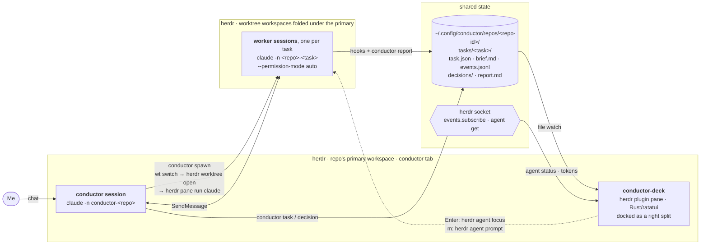
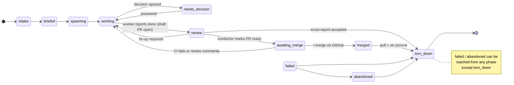

# Conductor design

Status: draft, pre-implementation. Last updated 2026-10-13.
Verified against Claude Code 2.1.296, herdr 0.9.4, worktrunk 0.64.0.

## Goal

Hand one Claude Code session a high-level goal and have it run the whole job:
break the goal into tasks, give each task to its own worker agent, supervise the
workers, review their work, and hand me finished PRs to merge on GitHub. This is the
"executive assistant" pattern. Show every task as a card in a deck docked on the
right side of herdr.

Conductor is a Claude Code-only, herdr-only rebuild of the ideas in
[firstmate](https://github.com/kunchenguid/firstmate) and
[captains-deck](https://github.com/deimantasnork/captains-deck). Assuming one
agent CLI and one multiplexer removes most of firstmate's ~125k lines of bash
(see [What we drop from firstmate](#what-we-drop-from-firstmate)).

### Scope

- One user (me), one machine, no remote sessions.
- One repo per conductor session. Several conductors, one per repo, can run at
  once.
- Claude Code and herdr only. Worktrees are created and removed with
  [worktrunk](https://worktrunk.dev), following my existing worktrunk config.
- Every ship task ends as a GitHub PR, and I merge it on GitHub. Nothing is
  merged locally; after a merge, the conductor just pulls the default branch
  and cleans up.
- Rust for all compiled code, so nothing needs a runtime.
- All shared state lives under `~/.config/conductor/`. Nothing requires
  launching from a particular repo.

### Non-goals (for now)

- A declarative workflow format. The workflow is prose in the `conductor`
  skill until two or three real patterns show what is worth abstracting.
- Supporting other agent CLIs or multiplexers.
- Approving permission prompts from the deck (focus the pane instead).
- Tasks that span repos.

## Architecture



### The two repos

| Repo | Contents |
|---|---|
| `conductor` (this repo) | The Claude Code plugin (skills, hooks, marketplace manifest). A Rust workspace with the `conductor` CLI and the `conductor-state` crate, which holds the shared types. |
| `conductor-deck` (separate) | The herdr plugin: `herdr-plugin.toml` plus a Rust/ratatui TUI. It depends on `conductor-state` through a git dependency pinned to a tag. |

Planned layout of this repo:

```
.claude-plugin/
  marketplace.json        this repo is its own marketplace
  plugin.json
skills/
  conductor/SKILL.md      the executive-assistant role and lifecycle
  worker/SKILL.md         brief protocol, status reporting, decisions
  status/SKILL.md         summarize all tasks for this repo
hooks/
  hooks.json              every hook calls `conductor hook <event>` through the shim
  conductor-hook.sh       the shim
crates/
  conductor/              the CLI binary
  conductor-state/        serde types for task.json, events, decisions, plus the JSON schema
docs/design.md
```

Install:

1. `cargo install --git https://github.com/erd/conductor conductor`, or
   `cargo install --path crates/conductor` during development.
2. `claude plugin marketplace add erd/conductor`
3. `claude plugin install conductor@conductor`

## State layout

```
~/.config/conductor/
  config.toml                         global defaults plus optional [repos."<repo-id>"] overrides
  repos/<repo-id>/
    repo.json                         repo root path, conductor session name, primary herdr workspace id, conductor pane id
    tasks/<task-id>/
      task.json                       task record (one writer: the conductor CLI)
      brief.md                        the task contract the worker reads
      events.jsonl                    append-only event log
      decisions/<key>.json            open questions and their answers
      report.md                       result summary or scout output
```

File format (`conductor-state`, which also publishes a JSON Schema at
`crates/conductor-state/schema/conductor-state.v1.json`):

- Every key and enum value is `snake_case`.
- `task.json`, `repo.json` and `decisions/<key>.json` carry `"schema":
  "conductor-state.v1"`. A reader rejects any other marker.
- Readers ignore unknown fields, and an unknown event `kind` is kept rather than
  rejected, so new fields and event kinds don't break older readers.

Naming:

- **`<repo-id>`**: the repo directory name plus a short hash of its canonical
  root path, e.g. `hamlet-web-v2-3f9a1c`.
- **`<task-id>`**: a short slug from the task title plus a counter, e.g.
  `fix-login-07`.
- **Session names**: the conductor is `conductor-<repo>` and each worker is
  `<repo>-<task-id>`. Peers address sessions by these names.
- **Branch**: `<branch_prefix><task-id>`. `branch_prefix` is set in config and
  defaults to `conductor/`. worktrunk places the worktree according to my
  config, which is `<repo>/.worktrees/<branch|sanitize>`.

Writing rules, which avoid locking and the crash-recovery logic firstmate needs:

- **`events.jsonl`** is only ever appended to, by conductor hooks and by
  `conductor report` / `conductor decision` calls. Each event is one small JSON
  line written with `O_APPEND`.
- **`task.json`** is written only by `conductor` CLI subcommands, and only with
  a write-temp-then-rename. Its fields: id, title, phase, branch, worktree path,
  session name, Claude session id, herdr workspace and pane ids, kind (`ship`
  or `scout`), PR URL, and timestamps. A worker's `report --pr` doesn't touch
  it: the URL stays in the `status` event, and readers take it from the fold.
- **`decisions/<key>.json`** is written only by `conductor decision open` and
  `conductor decision answer`, the same write-temp-then-rename way.
- **The deck never writes** state files. It works out live status by
  replaying the events and reading herdr's own agent state, and answers a
  decision by running `conductor decision answer --by deck`.

### Event types (`conductor-state`)

Every event carries `ts`, `task`, `kind`, and `session_id` (when known).

| kind | Source | Payload |
|---|---|---|
| `session_start` | SessionStart hook | `source`, `herdr_pane_id`, `herdr_workspace_id`, `transcript_path` |
| `prompt` | UserPromptSubmit hook | first line of the prompt (truncated) |
| `tool_start` / `tool_end` | PreToolUse / PostToolUse and PostToolUseFailure hooks | `tool_name`, a short summary (file path, command head), `tool_use_id?`, `ok` (end only) |
| `attention` | Notification hook | `type` (`permission_prompt`, `idle_prompt`, …), message |
| `turn_end` | Stop / StopFailure hooks | `error?` |
| `session_end` | SessionEnd hook | `reason` |
| `status` | `conductor report <verb> ["<text>"] [--pr <url>]` (worker) | verb: `working`, `blocked`, `done`, `failed`, plus text, `pr_url?` |
| `decision_open` / `decision_answered` | `conductor decision open` (worker) / `conductor decision answer` (the deck or the conductor) | `key` |
| `phase` | `conductor task phase …` (conductor) | `from`, `to` |
| `pr` | `conductor watch` polling `gh pr view` | `state` (draft, open, merged, closed), `checks` (pass, fail, pending), `review` (`reviewDecision`) |

Live activity on a card comes from the most recent hook events: working on
`Edit src/x.rs`, waiting on a permission prompt, idle, or exited. The task's
`phase` is a separate field and changes only on purpose.

## Task lifecycle (the executive-assistant workflow)

The `conductor` skill gives the conductor session its role. Its rules, carried
over from firstmate:

- It never edits project code itself.
- It never merges. I merge PRs on GitHub.
- It never tears down a ship task until GitHub reports its PR merged, or I
  abandon the task.
- I talk only to the conductor; workers never talk to me directly.

Phases:



1. **Intake.** Capture the goal and split it into one or more tasks. Ask me
   only about ambiguity that would block the work. Classify each task:
   - *ship*: produces a change.
   - *scout*: produces `report.md` and no change.
2. **Brief.** `conductor task new --title … --kind ship|scout [--intent …]`
   creates each task in `intake` and scaffolds its `brief.md` with these
   sections: my intent (verbatim), spec, acceptance criteria, constraints, kind
   (`ship` | `scout`), and worker rules (the `worker` skill, plus the task id,
   branch and session names). The conductor fills in the rest, then runs
   `conductor task phase <task> briefed`.
3. **Spawn.** Run `conductor spawn <task>` on a `briefed` task. It moves the
   task to `spawning`, then:
   1. runs `wt -C <repo> switch --create <branch> --no-cd --format=json` and
      records `path` and `branch`;
   2. runs `herdr worktree open --cwd <repo-root> --path <path> --label
      <task> --no-focus --json`, which folds the new workspace under the
      conductor's, and records the workspace and pane ids;
   3. runs `herdr pane run <pane> "env CONDUCTOR_TASK_ID=<task>
      CONDUCTOR_REPO_ID=<repo-id> CONDUCTOR_HOME=… claude -n <repo>-<task> --permission-mode auto 'Read
      your brief at <path> and follow the conductor worker skill.'"`, adding
      `--model`/`--effort` when config sets them. The line goes through `env`,
      and its quoting keeps backslashes out of single quotes, so it reads the
      same in bash, zsh and fish.

   It writes everything to `task.json` in one go and moves the task to
   `working`. If a step fails, the task moves to `failed` instead, with the
   error in a `status` event, and `task.json` records only what was actually
   created so teardown can remove it. Spawn refuses a task that already has a
   pane, and a branch that already exists unless given `--reuse-branch`.
   `--dry-run` prints the commands without running them.
4. **Supervise.** Wake on worker messages and on events (see [Waking the
   conductor](#waking-the-conductor)). Answer decisions the conductor can
   resolve itself. Pass the rest to me as decision files, which the deck
   shows.
5. **Review.** When a worker reports `done`, it has already pushed and opened
   a draft PR, so CI starts right away. The conductor reviews the PR diff,
   using a review subagent where useful.
   - If changes are needed, it sends fix-ups back over `SendMessage`; the
     worker pushes to the same branch.
   - If the PR is good, it runs `gh pr ready` and tells me the URL. A non-draft
     PR always means the conductor has signed off.
   - For a scout, the conductor reads `report.md`, summarizes it for me, and
     goes straight to teardown.
6. **Awaiting merge.** I review and merge on GitHub. `conductor watch` polls
   each task's PR (see [Waking the conductor](#waking-the-conductor)) and wakes
   the conductor:
   - when CI fails or review comments ask for changes: the conductor relays
     them to the worker, and the task goes back to `working`;
   - when the PR is merged: the task moves to `merged`;
   - when the PR is closed without merging: the conductor asks me whether to
     abandon the task.
7. **Tear down.** This happens only after GitHub reports the PR merged, or I
   abandon the task.
   1. Pull the default branch in the primary checkout with `git pull
      --ff-only`, but only if that checkout is on the default branch and
      clean. Otherwise fetch and warn.
   2. Stop the worker session.
   3. Run `wt remove <branch>`. worktrunk recognizes squash and rebase merges
      against the updated default branch and deletes the branch itself. If
      its check gives up (its history walk is capped), fall back to `wt remove
      -D`, which is safe because GitHub already reported the merge.
   4. Close the herdr workspace.
   5. Report to me.

### Resume

Closing the conductor's workspace row in herdr closes every worker workspace
folded under it. The worktrees, branches and task state survive. To get the
workers back, rerun `conductor start`, then `conductor resume [<task>...]`.
With no ids it covers every task in `working`, `needs_decision`, `review` or
`awaiting_merge`. It lists herdr's panes once, skips a task whose recorded pane
is still open, and for each of the others:

1. takes the session id from the task's latest `session_start` event, and
   fails that task with a clear error if there is none;
2. runs `herdr worktree open --cwd <repo-root> --path <worktree> --label
   <task> --no-focus --json`, and records the new workspace and pane ids in
   `task.json` straight away, so teardown can close them even if the next step
   fails;
3. runs `herdr pane run <pane> "env … claude --resume <session-id> -n
   <repo>-<task> --permission-mode auto"`, with the same environment,
   `--model`/`--effort` and quoting as spawn.

The phase doesn't change. One task failing doesn't stop the rest; resume exits
non-zero at the end if any failed. `--dry-run` prints the commands without
running them. Restoring the conductor's own session is out of scope:
`conductor start` starts a fresh one.

### Worker protocol (`worker` skill)

- Read the brief, and work only inside the worktree.
- Report progress with `conductor report working "<what>"` at milestones.
  Low-level activity comes from hooks for free.
- When blocked on a question, run `conductor decision open <key> --title …
  --option <value>=<label>[:<hint>] …`. Then `SendMessage` to `conductor-<repo>` with a one-line
  summary, and end the turn.
- On finishing a ship task: push the branch, open a draft PR with `gh pr
  create --draft`, and run `conductor report done --pr <url>`. Then
  `SendMessage` the conductor and end the turn.
- On finishing a scout: write `report.md`, run `conductor report done`, then
  `SendMessage` the conductor and end the turn.
- Handle fix-ups (from the conductor, CI, or review comments it relays) by
  pushing more commits to the same branch.
- Never mark the PR ready, never merge, never tear down, never message me
  directly.

## Communication

| Direction | Mechanism |
|---|---|
| conductor → worker | `SendMessage` to `<repo>-<task>`. Verified working on an idle interactive worker. |
| worker → conductor | `SendMessage` to `conductor-<repo>`, plus `conductor report` events. Verified working. |
| deck → worker | `herdr agent prompt <pane> "<text>"`. Verified working; `--wait` returns when the turn ends. herdr refuses this while the agent is `blocked`. |
| deck → conductor | `herdr agent prompt <conductor-pane> "<text>"` |
| hooks → everyone | append to `events.jsonl` |

Claude Code has no CLI or documented socket protocol for sending a
cross-session message from a non-Claude process, so the deck uses herdr's
prompt command instead.

### Waking the conductor

A message from a worker starts a new turn in an idle conductor (verified).
Messages alone don't cover crashes, permission prompts, or a worker that
forgets to report, so there is a backstop:

- **Primary:** workers `SendMessage` the conductor on done, blocked, or
  needs-decision.
- **Backstop:** a Stop hook on the conductor session (`CONDUCTOR_ROLE=conductor`)
  starts `conductor watch` as an `asyncRewake` hook with an 8 h timeout. The
  plugin registers it for every session, and the shim (`conductor-hook.sh
  watch`) exits 0 at once unless `CONDUCTOR_ROLE=conductor`. This
  is the same technique firstmate uses. `conductor watch` follows every task's
  `events.jsonl` and exits 2, which wakes the conductor, on any of:
  `attention`, `turn_end` without a matching `status` report, `session_end`, or
  `decision_open`. It writes a short wake summary to stderr, one line per
  task, e.g. `fix-login-07: needs permission (Bash: rm -rf build)`. An
  `idle_prompt` attention doesn't wake it: Claude sends one a minute after
  every turn ends, and the `turn_end` rule already covers that. A turn that
  ends on an API error always wakes it.
  - It follows only live tasks (not `torn_down` or `abandoned`), and picks up
    new task directories as they appear. It waits on file notifications, with
    a once-a-second rescan as a fallback.
  - Per-task byte offsets, and the little state the wake rules need from
    earlier events, live in `repos/<id>/watch.cursor`, so a restarted watcher
    never wakes twice on the same event. A first run (no cursor file) starts
    at the end of each log.
  - `flock` on `repos/<id>/watch.lock` keeps it to one watcher per repo; a
    second one exits 0 at once.
  - `--max-wait` (default 8 h, the hook's timeout) makes it exit 0 with
    nothing to report.
- **PR polling:** while a task has an open PR, `conductor watch` also runs
  `gh pr view <url> --json state,isDraft,reviewDecision,statusCheckRollup`
  every `pr_poll_interval` (default 2 minutes). It appends a `pr` event when
  anything changes. It wakes the conductor on: merged, closed, checks failed,
  or changes requested.
  - The PR URL comes from `task.json`, else from the worker's latest `status`
    event. Tasks without one are never polled, and a merged PR isn't polled
    again.
  - It wakes on transitions: into merged or closed, from not-failing to failing
    checks, and into changes requested. The wake comes from reading back the
    `pr` event it appended, so the cursor rules above apply: a restarted
    watcher wakes on a `pr` event it appended but never reported, and never
    wakes twice on one.
  - A failing `gh` (network, rate limit, auth) is retried with exponential
    backoff from the poll interval up to 15 minutes, logged to
    `logs/watch.log`; it never makes the watcher exit non-zero. If `gh` can't
    be run at all, it warns once and stops polling.
- **Supplementary:** when the conductor messages a worker, it can pass
  `notify_when_idle: true` to get one notice when that worker's turn ends,
  including a short summary of the turn. Each subscription fires once, so the
  conductor re-subscribes with every message. Notices queue while the
  conductor is busy and arrive once it is idle, so they can lag. This doesn't
  replace the backstop.

### Hooks in non-conductor sessions

The plugin is installed at user scope, so its hooks fire in every Claude
session on the machine. The hook command is a small shim that execs
`~/.cargo/bin/conductor hook <event>` (or `$CONDUCTOR_BIN`) if the binary
exists and exits 0 otherwise. It is registered for SessionStart,
UserPromptSubmit, PreToolUse, PostToolUse, PostToolUseFailure, Notification,
Stop, StopFailure and SessionEnd. The binary returns immediately unless `CONDUCTOR_TASK_ID` or
`CONDUCTOR_ROLE` is set. Measured cost: about 8.5 ms per hook versus 4.6 ms
for `sh -c true`, the same as a `jq` call. That is negligible.

In a conductor session the hook finds its state dir from `CONDUCTOR_REPO_ID`,
which `conductor start` and spawn set alongside `CONDUCTOR_ROLE` and
`CONDUCTOR_TASK_ID`. It always exits 0 and prints nothing, since Claude would
parse stdout as hook output. Errors go to `logs/hook.log` in the state dir,
which is moved to `hook.log.1` once it reaches 1 MiB.

## Permissions

- The conductor and all workers run with `--permission-mode auto`.
- **Never use `bypassPermissions` / `--dangerously-skip-permissions` for
  workers.** Firstmate does this, but Claude's cross-session messaging holds
  messages for approval when the receiver is in bypass mode and the sender is
  not, and the held messages expire after 5 minutes. Auto and the other
  prompting modes deliver to each other without a dialog (verified).
- Prompts that auto mode still raises (explicit `ask` rules, protected paths,
  and so on) produce a Notification hook event. The deck shows the card as
  needing attention; I focus the pane and answer there.
- Folder trust: worktrunk worktrees sit inside the repo (`.worktrees/`), and
  trust is keyed on the main checkout, so workers start with no trust dialog
  (verified). The repo itself must have been trusted once.
- worktrunk project-hook approvals: when a repo has project hooks
  (`.config/wt.toml`) I haven't approved, scripted `wt switch` exits 1 with
  "Cannot prompt for approval in non-interactive environment" and creates
  nothing (verified). `conductor spawn` surfaces that message and tells me to
  run `wt config approvals add` in the repo. It never passes `-y`.

## The deck (`conductor-deck`)

- **Placement:** a herdr plugin `[[panes]]` entry. It opens as
  `placement = "split"`, `--direction right`, targeting the conductor's pane in
  the conductor's tab. It stays there: workers live in their own folded
  workspaces, and the herdr sidebar covers navigation when I jump into one.
- **Width:** after opening, the deck sets its width with
  `layout.set_split_ratio`, and recomputes the ratio from the terminal width on
  `layout.updated` to stay close to the configured `deck_width` in columns.
- **Opening:** the conductor's SessionStart hook runs `herdr plugin pane open
  --plugin conductor-deck --entrypoint deck --placement split --direction right
  --target-pane $HERDR_PANE_ID`, unless the deck plugin isn't installed and
  enabled or the deck is already open. herdr doesn't report which plugin owns a
  pane, but it labels a plugin pane with its manifest title, so "already open"
  means a pane in the conductor's workspace labelled with the deck pane's
  title. There is also a herdr keybinding action to toggle it.
- **Data:**
  - a file watch on `repos/<repo-id>/tasks/*/`;
  - herdr `events.subscribe` (NDJSON over `HERDR_SOCKET_PATH`) for
    `pane.agent_status_changed`;
  - `herdr agent get <pane>` for tokens, context % and usage limit, which
    herdr already exposes.
  - It resyncs from `herdr api snapshot` on `events_lost`.
- **Card:** task title and id, phase badge, live activity line (current tool,
  or "needs permission", "waiting on decision", "idle"), elapsed time in that
  state, context %, branch, and the PR line (draft or ready, checks, review
  decision, from the latest `pr` event). Cards needing attention sort to the
  top, and `awaiting_merge` cards sort just below them.
- **Keys:** `Enter`/click runs `herdr agent focus <pane>`. `m` messages the
  worker. `d` answers an open decision: it runs `conductor decision answer
  --by deck` and prompts the worker. `o` opens the PR in the browser. `c` focuses the
  conductor. `L` shows or hides torn-down tasks.
- **Build:** herdr's `[[build]]` step runs `cargo build --release` on install.
  Plugin panes start with a minimal `PATH`, so the deck finds herdr through
  `HERDR_BIN_PATH` and uses absolute paths for everything else.

## What we drop from firstmate

| firstmate subsystem | ~Lines | Conductor replacement |
|---|---|---|
| Support for many agent CLIs (adapters, launch templates, per-CLI supervision) | 10k+ | Claude only |
| Five multiplexer backends, screen classifier, typed "doorbell" line, inbox re-ring | 10k | herdr CLI plus `SendMessage` |
| Text status parser, bash watcher, wake queue, guards | 20k | typed events, `conductor watch` through `asyncRewake` |
| Trust-dialog handling (editing `~/.claude.json`) | — | not needed: worktrunk worktrees inherit trust |
| Remote "secondmate" sessions, relay/voice/mail, Gerrit/GitLab/Forgejo, no-mistakes | 40k | out of scope |

Kept from firstmate:

- a durable on-disk record for every task (its reason for forbidding native
  subagents still holds);
- the brief file as the task contract;
- agents never merge;
- checking that work has landed (here: the PR is merged on GitHub) before
  teardown;
- the `asyncRewake` Stop-hook technique for waking the conductor.

## Spike results (2026-10-13)

| Question | Result |
|---|---|
| Does `claude -n <name> --permission-mode auto '<prompt>'` work interactively? | Yes. It ran the prompt, showed `conductor-spike` in the prompt bar, and appeared in `ListAgents` under that name. |
| Do messages between auto-mode sessions arrive with no dialog? | Yes, in both directions, tagged `from-mode="prompting"`. An idle worker picked the message up and replied. |
| Does `notify_when_idle` work? | Yes, with a delay. Both notices (turns ending 19:05 and 19:06) arrived only after the subscribing session finished its own long turn. They include a one-line summary of the worker's turn. |
| Do env vars reach the worker and its tools? | Yes: `CONDUCTOR_TASK_ID`, `HERDR_PANE_ID` and `HERDR_WORKSPACE_ID`. |
| Trust dialog in a worktrunk worktree? | None. |
| Does the worktree workspace fold under the conductor? | Yes. `herdr worktree open --cwd <repo-root>` attached it to the repo's primary workspace, the one the conductor runs in. |
| Does `herdr agent prompt --wait` reach a Claude worker? | Yes. It also returns the Claude session id and token, context and limit stats. |
| What does `wt` do with unapproved project hooks when scripted? | Exits 1 with a clear message and creates no worktree. |
| `wt switch --format=json` output | `{"action","branch","path","created_branch","base_branch"}` |
| Hook overhead in non-conductor sessions | About 3.9 ms over a bare `sh` (Rust binary, release + LTO, 376 KB). |
| Binary install | cargo 1.98 installed; `~/.cargo/bin` is on PATH. |

## Risks and open items

- **herdr churn.** Plugin v1 is "an early interface" and herdr releases every
  1–3 weeks. Pin `min_herdr_version` and keep herdr calls in one module of the
  deck.
- **Holding the deck width.** Splits are ratio-based, so a fixed column width
  depends on recomputing the ratio on every `layout.updated`. Verify this
  doesn't fight manual resizes.
- **Closing the conductor's workspace row closes every worker workspace.** The
  worktrees and branches survive, and `conductor resume` reopens the workers
  (see [Resume](#resume)). The conductor's own session starts fresh.
- **Auto mode reviews every `SendMessage` before sending it.** That adds
  latency and the possibility of a refusal. Watch for this once real tasks run.
- **Nothing in `asyncRewake` tells the conductor what woke it.** It has to read
  `conductor watch`'s stderr summary or call `conductor status`.
- **Optional:** start the conductor with `claude --agent conductor:conductor`
  (a main-thread agent definition from the plugin) instead of invoking a
  skill. The `--agent` flag exists; how it behaves with plugin agents is
  unverified.

## Milestones

1. **`conductor-state` + `conductor` CLI core:** `hook`, `report`, `decision`,
   `task`, `spawn`, `teardown`, `status`.
2. **Plugin:** hooks shim, `worker` and `conductor` skills, marketplace
   manifest. Test end to end on one task in one repo with no deck, using
   `conductor status` only.
3. **`conductor watch`** and the conductor's `asyncRewake` Stop hook.
4. **`conductor-deck`:** read-only cards, then focus and message, then
   decision answers.
5. **PR lifecycle:** draft PR → `gh pr ready`, PR polling in `conductor
   watch`, pull + `wt remove` teardown, `conductor resume`.
